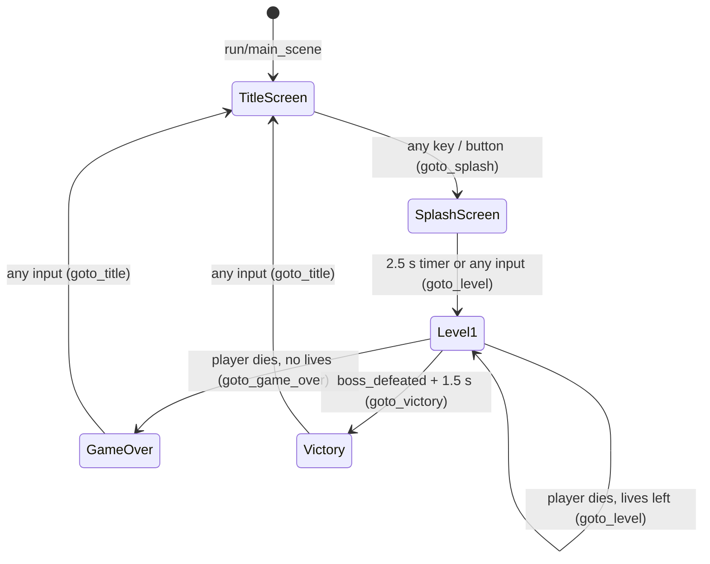
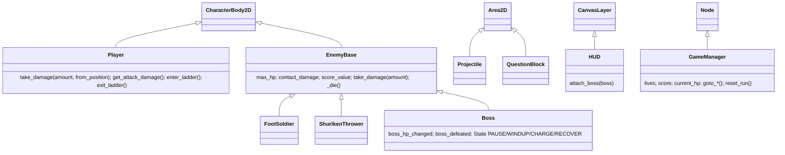

# Steel Streets — Architecture

Technical reference for the `steel_streets/` demo game. For how to run and
play it, see [README.md](README.md). This document describes how the pieces
fit together so engine or game changes can be made with the full picture.

## Relationship to the engine tree

`steel_streets/` is a plain Godot 4 project living inside the engine source
tree. It is **not** an engine module: it is not compiled by SCons, has no
`SCsub`, and does not register anything with `ClassDB`. It is loaded at
runtime by any Godot 4.3+ binary (including the editor built from this repo)
via `--path steel_streets`.

The project is pinned to the `GL Compatibility` renderer
(`renderer/rendering_method="gl_compatibility"` in `project.godot`) so it runs
on the GLES3 / OpenGL backend and does not require Vulkan.

## Scene flow

`GameManager` (`scripts/game_manager.gd`) is the only autoload singleton. It
owns the persistent run state (lives, score, HP) and is the single place that
calls `SceneTree.change_scene_to_file()`.



| Scene | Script | Notes |
| ----- | ------ | ----- |
| `scenes/title_screen.tscn` | `scripts/title_screen.gd` | Calls `GameManager.reset_run()` in `_ready()`; blinks "PRESS START". |
| `scenes/splash_screen.tscn` | `scripts/splash_screen.gd` | Auto-advances after `HOLD_TIME` (2.5 s). |
| `scenes/level_1.tscn` | `scripts/level_1.gd` | The whole level is generated in code (see below). |
| `scenes/game_over.tscn` | `scripts/game_over.gd` | Any input returns to title. |
| `scenes/victory.tscn` | `scripts/victory.gd` | Any input returns to title. |

`GameManager` signals (`score_changed`, `lives_changed`, `hp_changed`) are the
contract between game logic and the HUD; nothing reads HUD state directly.

## Level construction (`scripts/level_1.gd`)

`level_1.tscn` contains only three nodes: `TileMap`, `Entities` (`Node2D`) and
`Bgm` (`AudioStreamPlayer`). Everything else is built procedurally in
`_ready()` so no large hand-authored `.tscn` has to be maintained:

1. `_build_tileset()` creates a `TileSet` from
   `assets/sprites/tiles/tileset.png` (a 1-row strip of 16x16 tiles; the
   named atlas coords are `A_BRICK`, `A_CONCRETE`, `A_ROOF`, `A_BRICK_BG`,
   `A_WINDOW`, `A_DOOR`, `A_SKY_DIAMOND`, `A_SKY_ZIGZAG`). Only
   `SOLID_TILES` get a full-tile collision polygon on physics layer `world`.
2. `_paint_background()` / `_paint_foreground()` paint TileMap layer 0
   (decor) and layer 1 (solid geometry) from the `PLATFORMS` table.
3. `_make_ladder()` and `_make_spike()` create ladder `Area2D`s and spike
   hazards from the `LADDERS` / `SPIKES` tables.
4. `_spawn_pickups()`, `_spawn_enemies()`, `_spawn_boss()`, `_spawn_player()`
   instantiate the packed scenes listed in the `*_SCENE` preloads at
   tile coordinates from the `PICKUPS`, `FOOT_SOLDIERS`, `SHURIKEN_THROWERS`
   and `BOSS_POS` tables.
5. `_spawn_player()` also attaches a `Camera2D` (position smoothing, limits
   clamped to `WORLD_W * TILE` x `WORLD_H * TILE`) as a child of the player.
6. `_spawn_hud()` adds `hud.tscn`; the boss is handed to the HUD via
   `call_deferred("_attach_boss_to_hud", boss)` so the HUD is ready first.

World constants: `TILE = 16`, `WORLD_W = 100`, `WORLD_H = 9`,
`GROUND_ROW = 8`. Level layout changes are made by editing the constant
tables at the top of the file, not by editing scenes.

## Entities



- **Player** (`scripts/player.gd`, `scenes/player.tscn`) — `CharacterBody2D`
  with `Sprite` (`AnimatedSprite2D`), `AttackHitbox` (`Area2D`, in group
  `player_attack`) and three `AudioStreamPlayer`s. Movement constants:
  `SPEED 60`, `JUMP_VELOCITY -190`, `GRAVITY 700`, `CLIMB_SPEED 50`. Attack
  window is `ATTACK_TIME 0.30 s` with the hitbox enabled only during the
  last 75 % of the swing; `INVINCIBLE_TIME 1.2 s` after damage. `_die()`
  calls `GameManager.take_life()` and then `goto_level()` or
  `goto_game_over()`.
- **EnemyBase** (`scripts/enemy_base.gd`) — shared base for all enemies.
  Expects optional child nodes `Sprite`, `Hurtbox`, `Hitbox`, `SfxHit`.
  `Hurtbox.area_entered` → damage from `player_attack` areas;
  `Hitbox.body_entered` → contact damage to the `player` group. `_die()`
  awards `score_value` and `queue_free()`s.
- **FootSoldier** (`scripts/foot_soldier.gd`) — patrols and turns at ledges
  (`_has_floor_ahead()`).
- **ShurikenThrower** (`scripts/shuriken_thrower.gd`) — stationary ranged
  enemy; `_fire()` instantiates `scenes/projectile.tscn`.
- **Boss** (`scripts/boss.gd`) — `max_hp 9`, `score_value 1000`; state
  machine `PAUSE → WINDUP → CHARGE → RECOVER`. Emits `boss_hp_changed` and
  `boss_defeated` (consumed by `HUD` and `level_1.gd`).
- **Projectile** (`scripts/projectile.gd`) — `Area2D` moving at `SPEED 110`
  for `LIFETIME 3 s`; frees itself on hitting the player, a `TileMap` or a
  `StaticBody2D`.
- **QuestionBlock** (`scripts/question_block.gd`) — pickup `Area2D`; awards
  `score_reward` (50) and `heal_amount` (1) when the player body or the
  player's attack area enters it.
- **HUD** (`scripts/hud.gd`, `scenes/hud.tscn`) — `CanvasLayer` that
  rebuilds heart icons on `hp_changed`, formats score as `%05d`, and shows a
  64 px boss bar once `attach_boss()` is called.
- **AnimUtil** (`scripts/anim_util.gd`) — `static func build(specs) ->
  SpriteFrames`; every animated entity declares a `FRAMES_SPEC` array
  (`name`, `path`, `count`, `w`, `h`, `fps`, `loop`) and slices horizontal
  strips into `AtlasTexture` frames at runtime. Sprite sheets therefore
  need no `.tres` SpriteFrames resources.

## Collision layers and groups

Layer names are declared in `project.godot` under `[layer_names]`.

| Bit | Value | Name | Used by |
| --- | ----- | ---- | ------- |
| 1 | 1 | `world` | TileMap solid tiles (also the ray-cast mask for `_has_floor_ahead()`) |
| 2 | 2 | `player` | `Player` body |
| 3 | 4 | `player_hitbox` | `Player/AttackHitbox` |
| 4 | 8 | `enemy` | Enemy bodies and `Hurtbox` areas |
| 5 | 16 | `enemy_hitbox` | Enemy `Hitbox` areas, `Projectile` |
| 6 | 32 | `ladder` | Ladder areas created in `level_1.gd` |
| 7 | 64 | `pickup` | `QuestionBlock` |
| 8 | 128 | `hazard` | Spike `Area2D`s created in `level_1.gd` |

Node groups used for runtime lookups: `player`, `player_attack`, `enemy`,
`boss`, `ladder`. Damage is always delivered by duck-typed calls
(`has_method("take_damage")`) rather than by class checks, so new entity
types only need to implement `take_damage()` and join the right group/layer.

## Rendering and presentation

- Internal resolution 160x144 (`window/size/viewport_*`), default window
  640x576 (4x), `stretch/mode="viewport"`, `stretch/aspect="keep"`.
- `default_texture_filter=0` (nearest) plus `snap_2d_transforms_to_pixel`
  and `snap_2d_vertices_to_pixel` keep pixel art crisp.
- Art is restricted to the four Game Boy greens `#e0f8d0`, `#88c070`,
  `#346856`, `#081820`.

## Asset pipeline (`tools/gen_assets.py`)

Every PNG under `assets/sprites/` and every WAV under `assets/audio/` is
generated by `tools/gen_assets.py` (Python 3, requires Pillow; uses the
stdlib `wave` module for audio). Sprites are described as rows of `.`/`0`–`3`
characters and rendered via `img_from_rows()`; sprite strips are assembled
with `hcat()`. `main()` runs, in order: `gen_player`, `gen_foot_soldier`,
`gen_shuriken_thrower`, `gen_boss`, `gen_projectile`, `gen_tileset`,
`gen_ui`, `gen_text_assets`, `gen_audio`.

```bash
python3 steel_streets/tools/gen_assets.py   # from repo root
```

Edit the generator and re-run it rather than editing PNG/WAV files by hand;
the committed binaries are its output. Godot's own `.import` sidecar files
are committed, but the `.godot/` import cache is ignored (see `.gitignore`).

## Extending the game

- **New enemy**: create `scenes/<name>.tscn` (`CharacterBody2D` on layer
  `enemy` with `Sprite`, `Hurtbox`, `Hitbox`, `SfxHit` children), write
  `scripts/<name>.gd` extending `res://scripts/enemy_base.gd`, add a
  `gen_<name>()` sprite generator, and add a spawn table plus `preload` in
  `level_1.gd`.
- **New level**: copy `level_1.gd`'s table-driven layout; add a
  `LEVEL_SCENE`-style constant and `goto_*()` helper to `GameManager`.
- **New HUD element**: subscribe to a `GameManager` signal in `hud.gd`; do
  not poll game state.
