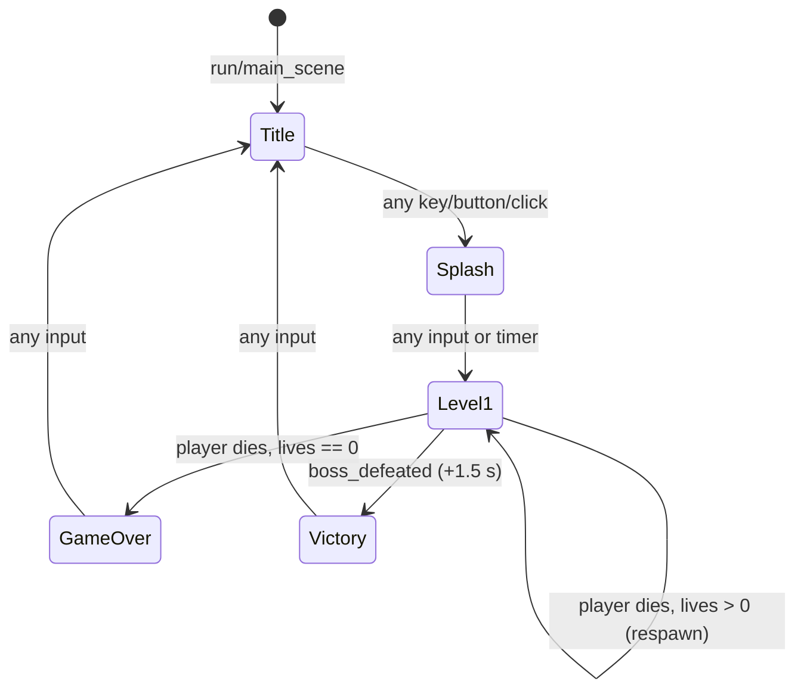

# Steel Streets — Architecture

Technical reference for the `steel_streets/` demo project. For how to run the
game and the controls, see [README.md](README.md). This document describes how
the project is put together so that changes can be made safely.

The demo is a pure GDScript Godot 4 project. It does **not** modify engine
code; the rest of this repository is an unmodified upstream Godot source tree
(see the top-level README for the fork relationship).

## Scene flow

All persistent state and every scene transition go through the
`GameManager` autoload (`scripts/game_manager.gd`). Screens never call
`change_scene_to_file` directly; they call one of the `goto_*` helpers.



| Scene | Script | Notes |
| --- | --- | --- |
| `scenes/title_screen.tscn` | `title_screen.gd` | Calls `GameManager.reset_run()` on `_ready`, so every visit resets lives/score/HP. |
| `scenes/splash_screen.tscn` | `splash_screen.gd` | Story card; skippable. |
| `scenes/level_1.tscn` | `level_1.gd` | The only playable level. Built procedurally in code (see below). |
| `scenes/game_over.tscn` | `game_over.gd` | Returns to title. |
| `scenes/victory.tscn` | `victory.gd` | Returns to title. |
| `scenes/hud.tscn` | `hud.gd` | `CanvasLayer`; instanced by `level_1.gd`, not by the level `.tscn`. |

## GameManager (autoload)

```gdscript
const STARTING_LIVES := 3
const STARTING_HP := 5
var lives, score, max_hp, current_hp
signal score_changed(new_score)
signal lives_changed(new_lives)
signal hp_changed(current, maximum)

func reset_run()          # title screen
func add_score(amount)    # enemies, question blocks
func set_hp(v) / heal(a)  # player damage / pickups
func take_life() -> bool  # false when no lives remain; refills HP otherwise
func goto_title() / goto_splash() / goto_level() / goto_game_over() / goto_victory()
```

The HUD subscribes to the three signals; nothing else listens to them. Player
HP is stored on `GameManager`, not on the player node, so it survives the
respawn scene reload.

## Level construction (`scripts/level_1.gd`)

`level_1.tscn` contains only a `TileMap`, an empty `Entities` `Node2D` and a
`Bgm` `AudioStreamPlayer`. Everything else is generated in `_ready()`:

1. `_build_tileset()` — builds a `TileSet` from
   `assets/sprites/tiles/tileset.png` (16x16 atlas, one row; atlas coords are
   the `A_*` constants). Solid tiles (`SOLID_TILES`) get a full-tile physics
   polygon on physics layer 0 → collision layer 1 ("world").
2. `_paint_background()` / `_paint_foreground()` — layer 0 is decorative sky
   and brick backdrop; layer 1 is the solid geometry from the `PLATFORMS`
   table (`[x0, y0, x1, y1, atlas]`, inclusive tile coordinates).
3. `_spawn_decor()`, `_spawn_pickups()` (`QUESTION_BLOCK_SCENE`),
   `_spawn_enemies()` (`FOOT_SOLDIER_SCENE`, `SHURIKEN_THROWER_SCENE`),
   `_spawn_player()`, `_spawn_boss()`, `_spawn_hud()`.
4. Ladders (`LADDERS`, `_make_ladder`) and spikes (`SPIKES`, `_make_spike`)
   are plain `Area2D`s created in code, not scenes.

World size is `WORLD_W` x `WORLD_H` tiles (100 x 9) at `TILE = 16` px;
`GROUND_ROW = 8`. To change the layout, edit the constant tables at the top
of the file rather than the `.tscn`.

The level uses the `TileMap` node (`get_layers_count()` / `add_layer()`),
which is deprecated in Godot 4.3+ in favour of `TileMapLayer` but still
ships with the engine in this tree.

## Entities

All animated entities build their `SpriteFrames` at runtime with
`AnimUtil.build(FRAMES_SPEC)` (`scripts/anim_util.gd`) from horizontal
strip PNGs — no `SpriteFrames` resources are stored in `.tscn` files.
A spec entry is `{name, path, count, w, h, fps, loop}`.

| Entity | Scene | Script | Base |
| --- | --- | --- | --- |
| Player | `player.tscn` | `player.gd` | `CharacterBody2D` |
| Foot soldier | `foot_soldier.tscn` | `foot_soldier.gd` | `enemy_base.gd` |
| Shuriken thrower | `shuriken_thrower.tscn` | `shuriken_thrower.gd` | `enemy_base.gd` |
| Boss | `boss.tscn` | `boss.gd` | `enemy_base.gd` |
| Shuriken | `projectile.tscn` | `projectile.gd` | `Area2D` |
| Question block | `question_block.tscn` | `question_block.gd` | `Area2D` |

### Player (`player.gd`)

Tuning constants live at the top of the file (`SPEED`, `JUMP_VELOCITY`,
`GRAVITY`, `CLIMB_SPEED`, `KNOCKBACK_*`, `INVINCIBLE_TIME`, `ATTACK_TIME`,
`ATTACK_COOLDOWN`, `ATTACK_DAMAGE`). `_physics_process` dispatches to
`_handle_grounded` or `_handle_climbing`; ladders toggle climbing via
`enter_ladder()` / `exit_ladder()` called from the level's ladder areas.

Damage flow: `take_damage(amount, from_position)` → checks i-frames →
`GameManager.set_hp()` → knockback → `_die()` if HP ≤ 0.
`_die()` calls `GameManager.take_life()` and then either `goto_level()`
(respawn by reloading the level) or `goto_game_over()`.

The melee attack is an `Area2D` child (`$AttackHitbox`) in group
`player_attack`, enabled only during `ATTACK_TIME`. Enemies read the damage
value back via `get_attack_damage()`.

### Enemies (`enemy_base.gd`)

Shared behaviour: HP, hit flash, contact damage, and death
(`GameManager.add_score(score_value)` then `queue_free()`). Each enemy scene
has three collision nodes:

- body (`CharacterBody2D`) — layer `enemy`, collides with `world`
- `Hurtbox` (`Area2D`) — layer `enemy`, detects `player_hitbox`
- `Hitbox` (`Area2D`) — layer `enemy_hitbox`, detects `player` body

`foot_soldier.gd` patrols and turns at edges (`_has_floor_ahead`).
`shuriken_thrower.gd` fires `projectile.tscn` on a timer.
`boss.gd` is a `PAUSE → WINDUP → CHARGE → RECOVER` state machine with
`max_hp = 9`, `score_value = 1000`, and emits `boss_hp_changed` /
`boss_defeated`; the level connects `boss_defeated` to the victory transition
and hands the boss to the HUD via `hud.attach_boss(boss)`.

## Collision layers and groups

Layer names are declared in `project.godot` (`[layer_names]`):

| Bit | Layer | Used by |
| --- | --- | --- |
| 1 | `world` | TileMap solid tiles |
| 2 | `player` | Player body |
| 3 | `player_hitbox` | Player `AttackHitbox` |
| 4 | `enemy` | Enemy bodies and hurtboxes |
| 5 | `enemy_hitbox` | Enemy contact hitboxes, projectiles |
| 6 | `ladder` | Ladder areas (code-built) |
| 7 | `pickup` | Question blocks |
| 8 | `hazard` | Spikes (code-built) |

Node groups used for cheap type checks: `player`, `player_attack`, `enemy`,
`boss`. Prefer `is_in_group(...) and has_method(...)` over class checks, as
the existing scripts do.

## Rendering / display

- 160x144 internal viewport, `stretch/mode = "viewport"`, `aspect = "keep"`,
  window override 640x576 (4x).
- `gl_compatibility` renderer on all platforms.
- Nearest-neighbour texture filtering and 2D pixel snapping are enabled
  globally in `project.godot`.
- Only the four Game Boy palette colours are used; `tools/gen_assets.py`
  enforces this at generation time.

## Asset pipeline (`tools/gen_assets.py`)

Every PNG in `assets/sprites/` and every WAV in `assets/audio/` is produced by
`tools/gen_assets.py` (requires Pillow). There is no external art source —
sprites are defined as ASCII rows of `.`/`0`–`3` inside the script, and SFX
are synthesised (`square_tone`, `slide`, `noise_burst`). Regenerate with:

```bash
python3 steel_streets/tools/gen_assets.py
```

The committed `*.import` sidecars are Godot's import settings; the `.godot/`
cache is git-ignored.

## Engine compatibility

`project.godot` declares `config/features = ["4.3", "GL Compatibility"]`. The
engine in this repository is newer (see `version.py`), so opening the project
with an editor built from this tree will upgrade the feature tag on save; the
project runs unchanged on any Godot 4.3+ binary.

## Running headless (CI / smoke test)

```bash
# Using an engine built from this repo:
./bin/godot.linuxbsd.editor.dev.x86_64 --path steel_streets --headless --quit-after 60
# Import assets only (populates steel_streets/.godot):
./bin/godot.linuxbsd.editor.dev.x86_64 --path steel_streets --headless --import
```
